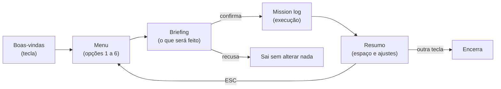

# 01 — Visão geral

← [Índice](README.md) · Próximo: [02 — Guia do usuário](02-guia-do-usuario.md)

> **Em uma frase:** o System Boost é um programa de terminal, escrito em Python, que limpa arquivos temporários do Windows e aplica ajustes de sistema que podem ser desfeitos depois, sempre mostrando antes o que vai fazer.

---

## 1. O problema

Com o tempo, um computador com Windows acumula duas coisas: **arquivos que ninguém mais usa** (temporários de instaladores, caches de ferramentas, a Lixeira) e **programas que rodam sem ninguém pedir** (apps que abrem com o sistema, serviços automáticos, tarefas agendadas).

Sem uma ferramenta, as perguntas do dia a dia ficam difíceis:

- "Quanto espaço eu recupero, e de onde?"
- "O que está abrindo junto com o Windows? Posso desligar sem quebrar nada?"
- "Mudei uma configuração há meses. Qual era o valor original?"
- "Meu driver de vídeo está atualizado?"

Muitos utilitários do tipo resolvem isso pedindo conta, vendendo licença ou aplicando mudanças que ninguém consegue desfazer. O System Boost responde às mesmas perguntas sem nada disso.

## 2. O que o programa faz, em uma figura

A Figura 1 mostra a jornada do fluxo guiado: boas-vindas, escolha do nível, briefing com tudo o que será feito, execução e resumo. Nada é alterado antes da confirmação.

**Figura 1 — Roteiro de telas do fluxo guiado**

## 3. Os quatro níveis

Cada nível inclui tudo o que o anterior faz e acrescenta mais. A Tabela 1 resume cada um; os detalhes estão em [Níveis de otimização](funcionalidades/01-niveis-de-otimizacao.md).

**Tabela 1 — Níveis de otimização**

| Nível | Tela | Em resumo |
| --- | --- | --- |
| **Leve** | STAGE 1: NORMAL | Temp do usuário, Lixeira e apps, serviços e tarefas de terceiros |
| **Mediana** | STAGE 2: BOOST | Soma Temp do Windows e caches, plano de energia, ofertas do Windows, precisão do ponteiro e hibernação |
| **Alta** | STAGE 3: TURBO BOOST | Soma Prefetch, efeitos visuais e indexação de pesquisa |
| **Extrema** | STAGE 4: HYPER DRIVE | Soma telemetria mínima, SysMain e Compatibility Appraiser |

## 4. Características principais

| Característica | O que significa na prática |
| --- | --- |
| **Fluxo guiado** | `python main.py` conduz da escolha do nível até o resumo |
| **Briefing** | Mostra pastas, tamanhos, ajustes e cada item de terceiros antes de executar |
| **Reversível** | Cada ajuste salva o valor anterior e pode ser desfeito individualmente ou em conjunto |
| **Filtro de terceiros** | Itens do Windows, antivírus, drivers, VPN, bancos de dados, backup, licenças e atualizadores não são tocados |
| **Adaptação à máquina** | HDD e notebook recebem um nível ajustado, e o briefing explica o que ficou de fora |
| **Limpeza conservadora** | Pula arquivos em uso, não segue links, mantém temporários com menos de 24 h e recusa pastas sensíveis |
| **Simulação** | `clean --dry-run` mede o que seria liberado sem apagar nada |
| **Drivers** | Windows Update e NVIDIA, um por um, com consentimento explícito |
| **Ponto de restauração** | Pedido ao Windows antes de uma execução alterar o sistema |
| **Mission log** | Uma linha por etapa, com estado em tempo real |
| **Visual retrô** | Três paletas Game Boy e efeitos sonoros 8-bit, ambos opcionais |
| **Instalador** | Executável único, sem exigir Python na máquina de destino |

## 5. Princípios

- **Sem login, sem conta, sem licença, sem telemetria.**
- **Mostrar antes de agir.** Nenhuma mudança acontece sem aparecer antes no briefing ou na confirmação.
- **Salvar antes de mudar.** O valor anterior vai para o disco antes de o ajuste ser aplicado.
- **Falhar sem parar o resto.** Um ajuste, uma pasta ou um driver com problema vira uma linha no log; a execução continua.
- **Admin só quando necessário, e nunca de surpresa.** Pelo código-fonte, o programa não se autoeleva. O que exige Administrador é pulado ou falha com uma mensagem clara. O executável pede elevação ao abrir, como qualquer instalador.
- **Nunca toca em pastas de jogos.**

## 6. O que o programa **não** faz (limites conhecidos)

A Tabela 2 separa o que volta do que não volta. Vale ler antes de escolher um nível.

**Tabela 2 — O que é e o que não é reversível**

| Ação | Reversível? | Como |
| --- | --- | --- |
| Os 12 ajustes | Sim | Opção 6 do menu ou `undo` |
| Arquivos apagados | **Não** | Sem desfazer; use `clean --dry-run` para medir antes |
| Lixeira esvaziada | **Não** | Todas as unidades; o briefing avisa |
| Drivers instalados | **Só pelo Windows** | Ponto de restauração criado antes da execução |

Outros limites:

- **Só Windows 10/11.** Há trechos de código para outros sistemas, mas só o Windows é suportado e testado.
- **Sem interface gráfica.** É um programa de terminal.
- **Sem execução agendada.** Ele só roda quando alguém manda.
- **Atalhos da pasta Inicializar não são resolvidos.** Eles são classificados só pelo nome do arquivo.
- **A consulta à NVIDIA usa um serviço público não oficial.** Se ele mudar, essa etapa é pulada com uma mensagem, sem afetar o resto.
- **Só a primeira GPU NVIDIA encontrada é verificada.**

## 7. Tecnologias em uma tabela

| Tecnologia | Para quê | Por que esta |
| --- | --- | --- |
| **Python 3.11+** | Linguagem do programa | Acesso direto ao registro e à API do Windows, com código curto |
| **rich** | Interface de terminal | Painéis, tabelas e atualização ao vivo prontos |
| **PowerShell** | Consultas de sistema (CIM, Windows Update, Lixeira) | Já vem no Windows e devolve dados estruturados |
| **PyInstaller** | Gera o `.exe` único | Dispensa Python na máquina de destino |
| **Inno Setup 6** | Gera o instalador | Gratuito, maduro, em português |
| **pytest** + **ruff** | Testes e lint | Padrão no ecossistema Python |
| **GitHub Actions** | Roda tudo automaticamente na nuvem | Garante que nada quebrado entre no repositório |
| **Mermaid** | Diagramas desta documentação | O GitHub desenha a partir de texto |

## 8. Sobre o nome

O projeto se chamava **WinCleaner**. O nome antigo continua na pasta de dados `%LOCALAPPDATA%\WinCleaner`, mantida de propósito: mudá-la faria instalações existentes perderem o histórico de desfazer. Ver [D3 em Decisões de projeto](08-decisoes-de-projeto.md#d3--pasta-de-dados-com-o-nome-antigo).

Autor: Felipe Grolla ([@Grolla05](https://github.com/Grolla05)). Licença: MIT ([LICENSE](../LICENSE)).

---

← [Índice](README.md) · Próximo: [02 — Guia do usuário](02-guia-do-usuario.md)
