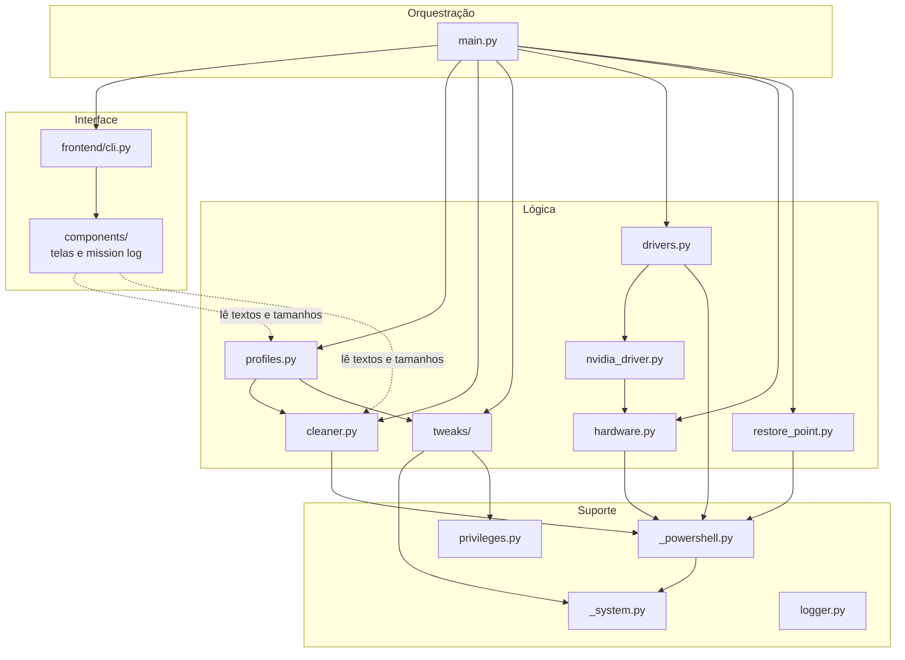
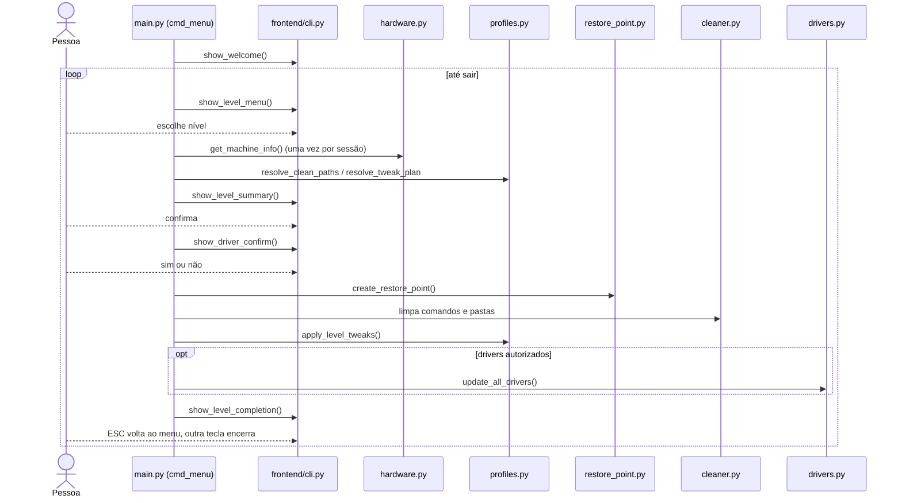
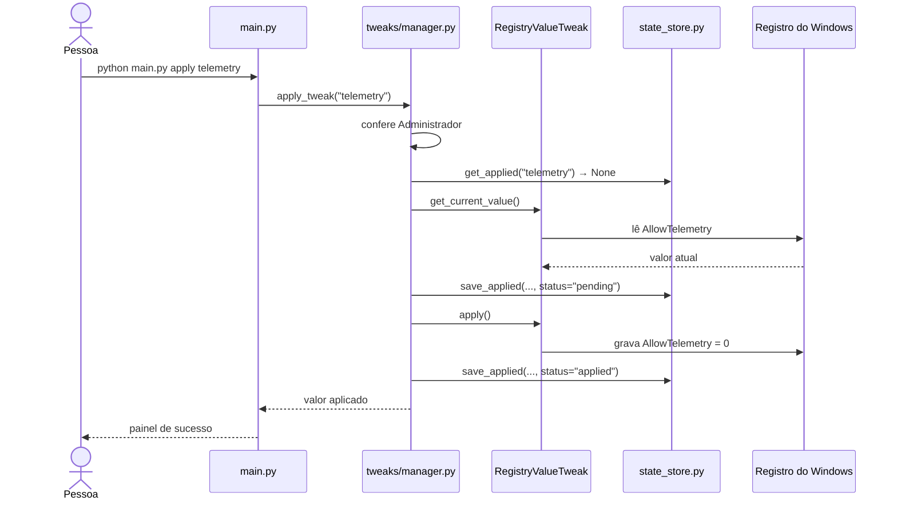

# 04 — Arquitetura

← Anterior: [03 — Conceitos fundamentais](03-conceitos-fundamentais.md) · [Índice](README.md) · Próximo: [Módulos do código-fonte](modulos/README.md)

> **Princípio central:** a **lógica** (o que limpar, como mudar o Windows, como desfazer) fica em `backend/` e não desenha nada. A **interação** (perguntar, mostrar, colorir) fica em `frontend/`. O `main.py` só amarra as duas partes.

---

## 1. Árvore do repositório

```text
System_Boost/
├── main.py                       ponto de entrada: argumentos e fluxos
├── backend/                      lógica, sem interface
│   ├── cleaner.py                medir e apagar com segurança
│   ├── profiles.py               os 4 níveis e a adaptação à máquina
│   ├── drivers.py                Windows Update e orquestração dos drivers
│   ├── nvidia_driver.py          consulta, download e instalação do driver NVIDIA
│   ├── hardware.py               ficha da máquina
│   ├── restore_point.py          ponto de restauração
│   ├── privileges.py             detecta Administrador
│   ├── logger.py                 log de diagnóstico em arquivo
│   ├── _powershell.py            executor de PowerShell compartilhado
│   ├── _system.py                caminhos absolutos das ferramentas do Windows
│   └── tweaks/                   subsistema de ajustes reversíveis
│       ├── base.py               classe abstrata Tweak e exceções
│       ├── catalog.py            os 12 ajustes
│       ├── manager.py            aplicar, desfazer, listar
│       ├── state_store.py        estado em JSON
│       ├── third_party.py        filtro de software de terceiros
│       └── *.py                  um arquivo por mecanismo
├── frontend/                     interface de terminal com rich
│   ├── cli.py                    ponte entre main.py e as telas
│   ├── palettes.py               paletas de cores
│   ├── audio.py                  efeitos sonoros
│   └── components/               uma tela ou peça por arquivo
├── tests/                        suíte pytest
├── build.py                      gera dist/System Boost.exe
├── installer.py, installer.iss   geram dist/System Boost Setup.exe
├── .github/                      CI, modelos de issue/PR e guias
├── docs/                         esta documentação
├── pyproject.toml                versão e configuração de pytest e ruff
├── requirements*.txt             dependências
└── README.md, CHANGES.md, LICENSE
```

As pastas `build/`, `dist/` e `logs/` são geradas e ignoradas pelo Git.

## 2. Camadas

A Figura 1 mostra o programa em três camadas. Cada camada só usa as de baixo.



**Figura 1 — Camadas e dependências (seta = "usa")**

A exceção consciente são as telas de briefing, que consultam `profiles` e `cleaner` para mostrar rótulos, prévias e tamanhos. Elas só leem; nada no `backend/` importa o `frontend/`.

A Tabela 1 resume o que cada módulo sabe e o que ele **não** sabe.

**Tabela 1 — Responsabilidades e fronteiras**

| Módulo | Responsável por | Não sabe nada de |
| --- | --- | --- |
| `cleaner` | Medir e apagar pastas, proteger raízes sensíveis | Níveis, telas |
| `profiles` | Definir níveis e decidir o que roda nesta máquina | Como cada ajuste funciona, telas |
| `tweaks.manager` | Ordem segura de aplicar e desfazer | Detalhes de cada mecanismo |
| Cada `Tweak` | Ler, aplicar e desfazer um mecanismo | Estado em disco, telas |
| `state_store` | Persistir o estado com segurança | Windows, telas |
| `drivers` | Procurar e instalar, um a um, com callbacks | Mission log |
| `hardware` | Ler a ficha sem levantar exceção | Telas, níveis |
| `frontend` | Desenhar e ler teclas | Como o Windows é alterado |
| `main` | Argumentos, ordem das etapas, ligar callbacks ao log | Detalhes de qualquer módulo |

Por que isso importa (detalhes em [08 — Decisões de projeto](08-decisoes-de-projeto.md)):

- **Testabilidade:** o backend é testado sem desenhar telas, com o Windows simulado.
- **Falhas isoladas:** um erro em uma etapa vira uma linha no log, sem derrubar as outras.
- **Trocar a interface:** uma interface gráfica reaproveitaria o backend sem mudanças.

## 3. Ciclo de vida do programa

A Figura 2 mostra o que acontece no fluxo guiado, do início ao fim. O código correspondente está em [main.py](../main.py), explicado em [modulos/main.md](modulos/main.md).



**Figura 2 — Ciclo de vida do fluxo guiado**

## 4. O caminho de uma ação: `apply telemetry`

Para ver as camadas trabalhando juntas, a Figura 3 segue um ajuste do comando até o registro.



**Figura 3 — Um ajuste atravessando as camadas**

Observações:

1. O registro `pending` vai para o disco **antes** de o Windows mudar. Uma queda no meio não perde o valor original.
2. Se `apply()` levantar `TweakError`, o registro é removido, porque nada foi alterado de forma confirmada.
3. Sem Administrador, o `manager` falha com mensagem clara, sem tentar se elevar.

## 5. Estruturas de dados do projeto

**Tabela 2 — Estruturas principais**

| Estrutura | Onde | Para quê |
| --- | --- | --- |
| `LEVELS` | `profiles.py` | Dicionário declarativo dos 4 níveis |
| `_UNSUITABLE` | `profiles.py` | Ajuste → regra que o exclui nesta máquina |
| `CLEAN_RULES` | `cleaner.py` | Regras extras por pasta: idade mínima e nomes preservados |
| `COMMAND_CLEANUPS` | `cleaner.py` | Rótulo, ferramenta exigida, medir e limpar de Lixeira, npm e uv |
| `MachineInfo` | `hardware.py` | Dataclass com a ficha; campos desconhecidos ficam `None` |
| `NvidiaUpdate` | `nvidia_driver.py` | GPU, versões e URL do driver disponível |
| Registro de ajuste | `state_store.py` | `previous_value`, `applied_value`, `status` e `_seq` por ajuste |
| `LogLine` | `live_log.py` | Uma linha do mission log |
| `PALETTES` | `palettes.py` | Estilos de cada tema |

## 6. Interfaces entre módulos (resumo)

**Tabela 3 — Principais funções públicas**

| Módulo | Funções |
| --- | --- |
| [cleaner](modulos/cleaner.md) | `get_temp_paths`, `clean_directory`, `get_dir_size`, `format_size`, `is_safe_clean_root`, `run_command_cleanup` |
| [profiles](modulos/profiles.md) | `resolve_clean_paths`, `resolve_tweak_plan`, `apply_level_tweaks`, `preview_tweak_items`, `machine_skips`, `machine_notes` |
| [tweaks](modulos/tweaks.md) | `apply_tweak`, `undo_tweak`, `undo_all`, `list_status`, `list_applied`, `get_tweak`, `list_tweaks` |
| [drivers](modulos/drivers.md) | `scan_drivers`, `install_driver`, `update_all_drivers`, `check_update`, `install_update` |
| [hardware](modulos/hardware.md) | `get_machine_info`, `is_notebook` |
| [suporte](modulos/suporte.md) | `run_powershell`, `system_exe`, `powershell_exe`, `cli_command`, `is_admin`, `create_restore_point`, `setup_logging`, `get_logger` |
| [frontend](modulos/frontend.md) | `show_*`, `apply_palette`, `cycle_active_palette`, `set_sound_enabled`, `MissionLog` |

## 7. Variáveis de ambiente

**Tabela 4 — Variáveis lidas pelo programa e pelo build**

| Variável | Quem lê | Efeito |
| --- | --- | --- |
| `LOCALAPPDATA` | Vários | Pasta de dados e caches |
| `TEMP` | `cleaner.py` | Localiza User Temp |
| `NPM_CONFIG_CACHE`, `UV_CACHE_DIR` | `cleaner.py` | Caches do npm e do uv fora do lugar padrão |
| `SYSTEM_BOOST_SIGN_THUMBPRINT` | `build.py` | Assina o exe com este certificado |
| `INNO_SETUP_COMPILER` | `installer.py` | Caminho do `ISCC.exe` |

---

← Anterior: [03 — Conceitos fundamentais](03-conceitos-fundamentais.md) · [Índice](README.md) · Próximo: [Módulos do código-fonte](modulos/README.md)
