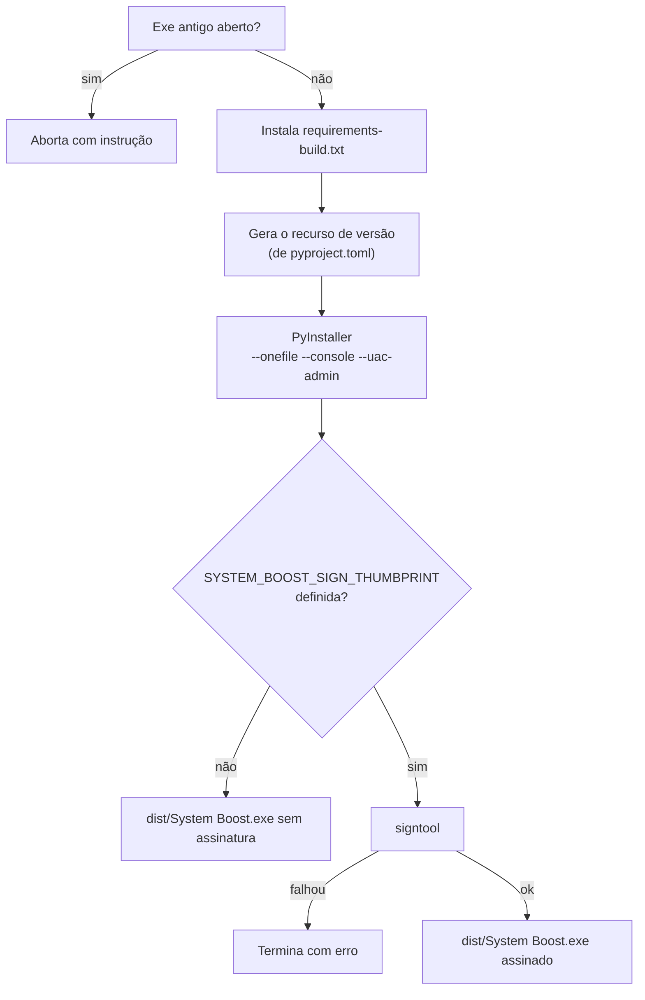

# 05 — Build e ambiente

← Anterior: [Módulos do código-fonte](modulos/README.md) · [Índice](README.md) · Próximo: [06 — Testes](06-testes.md)

> Como preparar a máquina, rodar pelo código, gerar o executável e gerar o instalador.

---

## 1. Ferramentas

**Tabela 1 — O que instalar**

| Ferramenta | Para quê | Obrigatória? |
| --- | --- | --- |
| Windows 10/11 | Sistema suportado | Sim |
| [Python 3.11+](https://www.python.org/downloads/windows/) | Rodar e empacotar | Sim |
| [Inno Setup 6](https://jrsoftware.org/isinfo.php) | Gerar o instalador | Só para o instalador |
| `signtool` (Windows SDK) | Assinar o exe | Só para assinar |

## 2. Dependências

As dependências ficam em três arquivos encadeados: cada um inclui o anterior.

**Tabela 2 — Arquivos de dependências**

| Arquivo | Conteúdo | Uso |
| --- | --- | --- |
| `requirements.txt` | `rich` | Rodar o programa |
| `requirements-build.txt` | + `pyinstaller` | Gerar o exe |
| `requirements-dev.txt` | + `pytest`, `pytest-cov`, `ruff` | Desenvolver |

## 3. Preparar o ambiente

```bash
git clone https://github.com/Grolla05/System_Boost.git
cd System_Boost
python -m venv .venv
.venv\Scripts\activate
pip install -r requirements-dev.txt
```

Confira que está tudo certo:

```bash
pytest
ruff check .
```

## 4. Rodar pelo código

```bash
python main.py
```

Abra o terminal como Administrador para testar limpezas e ajustes que exigem elevação. Lembre-se de que o programa altera o Windows de verdade. Para só observar, use `python main.py clean --dry-run`, `python main.py list` ou `python main.py info`.

## 5. Gerar o executável

```bash
python build.py
```

A Figura 1 mostra as etapas do `build.py`.



**Figura 1 — Etapas do build**

O exe gerado:

- **Sempre pede Administrador** ao abrir (manifesto `requireAdministrator`).
- Traz `System Boost by Felipe Grolla` em **Propriedades → Detalhes**.
- Lê a versão de `pyproject.toml`, a única fonte da versão.

## 6. Assinatura e o "Editor desconhecido"

O Windows só mostra um editor verificado no UAC quando o exe tem assinatura Authenticode com um certificado emitido para aquele nome. Sem isso, o aviso diz "Editor: Desconhecido", qualquer que seja o conteúdo dos metadados.

Com um certificado de assinatura de código no repositório de certificados do Windows, informe a impressão digital SHA-1:

```powershell
$env:SYSTEM_BOOST_SIGN_THUMBPRINT = "<thumbprint>"
python build.py
```

## 7. Gerar o instalador

```bash
python installer.py
```

O script localiza o `ISCC.exe`, roda o `build.py`, compila o `installer.iss` e confere o resultado. O instalador sai em `dist/System Boost Setup.exe`. Para empacotar um exe já construído:

```bash
python installer.py --skip-build
```

Se o compilador não estiver no `PATH` nem no local padrão, indique o caminho:

```powershell
$env:INNO_SETUP_COMPILER = "C:\Program Files (x86)\Inno Setup 6\ISCC.exe"
python installer.py
```

Detalhes do instalador estão em [07 — CI e instalador](07-ci-e-instalador.md).

## 8. Problemas comuns

| Sintoma | Causa | Solução |
| --- | --- | --- |
| `Build aborted: ... still running` | Exe antigo aberto | Feche a janela e rode de novo |
| `Inno Setup compiler ... was not found` | `ISCC.exe` não localizado | Instale o Inno Setup 6 ou defina `INNO_SETUP_COMPILER` |
| `Signing failed` | Certificado ou `signtool` indisponível | Confira o thumbprint e o Windows SDK, ou remova a variável |
| `Required file not found` com `--skip-build` | Exe ainda não existe | Rode `python build.py` antes |
| `requer privilégios de administrador` | Terminal sem elevação | Reabra como Administrador |

---

← Anterior: [Módulos do código-fonte](modulos/README.md) · [Índice](README.md) · Próximo: [06 — Testes](06-testes.md)
