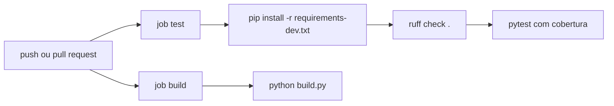

# 07 — CI e instalador

← Anterior: [06 — Testes](06-testes.md) · [Índice](README.md) · Próximo: [08 — Decisões de projeto](08-decisoes-de-projeto.md)

> Como o repositório se verifica sozinho a cada envio e como o instalador do Windows é montado.

---

## 1. GitHub Actions

O arquivo [.github/workflows/ci.yml](../.github/workflows/ci.yml) roda em todo `push` e `pull_request`, com dois jobs em `windows-latest` e Python 3.11.

**Figura 1 — Pipeline de CI**

**Tabela 1 — Jobs**

| Job | Verifica |
| --- | --- |
| `test` | Lint e suíte de testes, com relatório de cobertura de `backend` e `frontend` |
| `build` | Que o `System Boost.exe` é gerado sem erro |

Duas escolhas de segurança valem para o arquivo inteiro: `permissions: contents: read` limita o que o workflow pode fazer, e as actions são fixadas por **SHA do commit**, para que uma tag alterada não mude o que roda. Ao atualizar uma action, troque o SHA e mantenha o comentário com a versão.

O CI não publica Releases nem gera o instalador. Isso é feito à mão, como descrito na seção 4.

## 2. O instalador em Inno Setup

O [installer.iss](../installer.iss) descreve o instalador. A Tabela 2 reúne as decisões principais.

**Tabela 2 — Comportamento do instalador**

| Item | Valor | Motivo |
| --- | --- | --- |
| `PrivilegesRequired` | `admin` | O exe sempre exige elevação; instalar por máquina é coerente |
| `DefaultDirName` | `{autopf}\System Boost` | `Program Files` |
| Idiomas | Português do Brasil e inglês | Público principal |
| Atalhos | Menu Iniciar e área de trabalho | Criados sempre |
| Pós-instalação | Abre o programa pelo atalho | Ver a seção 3 |
| Cópia antiga | Remove `{localappdata}\Programs\System Boost` | Versões até 0.1.0 instalavam por usuário |
| Desinstalação | Oferece `undo --all` antes de remover | Depois de remover, ninguém mais restaura os valores |

## 3. Por que abrir pelo atalho

As entradas `postinstall` do Inno Setup rodam como o usuário original, sem elevação. Como o exe exige Administrador, um `CreateProcess` direto falharia com o erro 740. Abrir pelo atalho com `shellexec` dispara o UAC normalmente.

## 4. Publicar uma versão

Ainda não há Releases publicadas nem tags no repositório. O processo manual é:

1. Atualize `version` em [pyproject.toml](../pyproject.toml), a única fonte da versão.
2. Confira que o `main` está verde no CI.
3. Rode `python installer.py`. Assine definindo `SYSTEM_BOOST_SIGN_THUMBPRINT`, se tiver certificado.
4. Teste o instalador e o desinstalador em uma máquina de teste.
5. Crie uma tag e publique uma Release com `dist/System Boost Setup.exe`.

---

← Anterior: [06 — Testes](06-testes.md) · [Índice](README.md) · Próximo: [08 — Decisões de projeto](08-decisoes-de-projeto.md)
