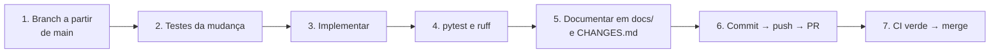

# 09 — Contribuindo

← Anterior: [08 — Decisões de projeto](08-decisoes-de-projeto.md) · [Índice](README.md) · Próximo: [10 — Glossário e FAQ](10-glossario-e-faq.md)

> Como trabalhar no código do System Boost sem quebrar nada. Complementa o [.github/CONTRIBUTING.md](../.github/CONTRIBUTING.md) e a [.github/COMMIT_CONVENTION.md](../.github/COMMIT_CONVENTION.md).

---

## 1. Fluxo de trabalho



**Figura 1 — Fluxo adotado no repositório**

- **Branches:** `feat/...`, `fix/...`, `chore/...` e `docs/...`, com nome descritivo em português, como `fix/limpeza-segura`.
- **`CHANGES.md`:** cada mudança ganha uma seção no topo, com o que mudou e em qual arquivo.
- **`main`:** recebe trabalho só por pull request.

## 2. Convenções de código

| Regra | Detalhe |
| --- | --- |
| Python | 3.11+, `ruff check .` sem avisos |
| Idioma | Identificadores, docstrings e comentários em inglês; mensagens e logs em pt-BR |
| Camadas | `backend/` não importa `frontend/` e não imprime ([04 — Arquitetura](04-arquitetura.md)) |
| Cores | Sempre pelo tema (`[accent]`, `[warning]`...), nunca fixas nas telas |
| Ferramentas do Windows | Sempre por `system_exe()` ou `powershell_exe()`, nunca pelo nome curto |
| Leituras do sistema | `winreg` antes de interpretar saída de `.exe`, que muda com o idioma |
| PowerShell | Sempre por `run_powershell`, com timeout |
| Falhas | Uma etapa com problema não derruba as outras |
| Log | `get_logger("<módulo>")`, nunca `print` no backend |

## 3. Mensagens de commit

Padrão **Conventional Commits**, descrito em [.github/COMMIT_CONVENTION.md](../.github/COMMIT_CONVENTION.md):

```text
<tipo>: <descrição curta no imperativo>
```

Exemplos reais do histórico: `fix: make temp cleanup stricter`, `feat: adapt levels to the machine and handle new items`.

## 4. Roteiro: adicionar um ajuste novo

Exemplo concreto: desligar a Game Bar, um valor DWORD no registro do usuário.

1. **Mecanismo:** veja se um existente resolve. Para um valor único no registro, `RegistryValueTweak` basta. Só crie um arquivo em `backend/tweaks/` para um mecanismo novo, implementando `get_current_value`, `apply` e `undo`.
2. **Catálogo:** registre o ajuste em `_build_catalog()` de [catalog.py](../backend/tweaks/catalog.py).
3. **Administrador:** use `requires_admin=True` se escrever em `HKLM`, serviços ou tarefas.
4. **Item a item?** Se o ajuste trata vários itens, defina `previews_items = True` e levante `TweakPartialUndo` no desfazer parcial.
5. **Testes:** em `tests/test_tweaks/`, cubra valor presente, valor ausente, falha de escrita e o par aplicar → desfazer.
6. **Nível:** acrescente o id em `tweak_ids` do nível certo em [profiles.py](../backend/profiles.py) e ajuste o texto da descrição. Se fizer mal a algum tipo de máquina, inclua em `_UNSUITABLE`.
7. **Validar:** `pytest` e `ruff check .`.
8. **Documentar:** atualize a tabela em [Ajustes reversíveis](funcionalidades/03-ajustes-reversiveis.md), a de [Níveis](funcionalidades/01-niveis-de-otimizacao.md), a contagem no `README.md` e o `CHANGES.md`.

## 5. Roteiro: proteger um software do filtro

Acrescente o nome em `EXCEPTION_NAMES` de [third_party.py](../backend/tweaks/third_party.py), na categoria certa, e um caso em `tests/test_tweaks/test_third_party.py`. Use `ANYWHERE_NAMES` só para termos que costumam vir colados a outro nome, como `vpn`.

## 6. Checklist antes do pull request

- [ ] Testes novos cobrem a mudança e passam.
- [ ] `pytest` e `ruff check .` sem erros.
- [ ] Nenhum teste toca o Windows, o registro ou a rede de verdade.
- [ ] Ajuste novo ou alterado tem desfazer testado.
- [ ] Mensagens para o usuário em pt-BR.
- [ ] Documentação em `docs/` atualizada (funcionalidade e módulo).
- [ ] `CHANGES.md` descreve a mudança.
- [ ] Modelo de PR ([.github/pull_request_template.md](../.github/pull_request_template.md)) preenchido.

## 7. Issues e segurança

Bugs e ideias entram pelos modelos em `.github/ISSUE_TEMPLATE/`: `bug_report.yml` e `feature_request.yml`. Problemas de segurança seguem o [.github/SECURITY.md](../.github/SECURITY.md).

## 8. Mantendo esta documentação

- O código é a fonte da verdade; se divergir, corrija a doc no mesmo PR.
- Uma funcionalidade nova ganha um arquivo em `docs/funcionalidades/` (próximo número livre) e uma linha nas tabelas de [funcionalidades/README.md](funcionalidades/README.md) e do [índice](README.md).
- Um arquivo de código novo entra no documento correspondente em `docs/modulos/`.
- Contagens de testes mudam com o tempo; ao alterar suítes, atualize a Tabela 2 de [06 — Testes](06-testes.md).

---

← Anterior: [08 — Decisões de projeto](08-decisoes-de-projeto.md) · [Índice](README.md) · Próximo: [10 — Glossário e FAQ](10-glossario-e-faq.md)
