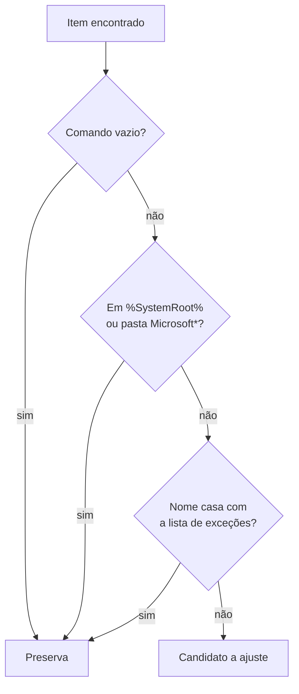

# 03 — Ajustes reversíveis

← Anterior: [02 — Limpeza de temporários](02-limpeza.md) · [Funcionalidades](README.md) · Próximo: [04 — Desfazer ajustes](04-desfazer.md)

**Acesso:** níveis do menu, `list` e `apply <tweak_id>`
**Código:** [backend/tweaks/](../../backend/tweaks/), explicado em [modulos/tweaks.md](../modulos/tweaks.md)
**Testes:** [tests/test_tweaks/](../../tests/test_tweaks/)

---

## 1. Para que serve

Muda configurações do Windows que reduzem o trabalho em segundo plano, guardando o valor anterior de cada uma para poder voltar atrás.

## 2. Como usar

```bash
python main.py list               # ajustes, admin, valor atual e status
python main.py apply power_plan   # aplica
```

## 3. Os 12 ajustes

**Tabela 1 — Catálogo de ajustes**

| Id | O que faz | Admin? | Nível | Valor salvo |
| --- | --- | --- | --- | --- |
| `startup_apps` | Desativa programas de terceiros na inicialização | Não¹ | Leve | Itens e bytes originais |
| `third_party_services` | Passa serviços automáticos de terceiros para manual e os para | Sim | Leve | Serviços e tipo de início |
| `third_party_tasks` | Desativa tarefas agendadas de terceiros | Sim | Leve | Tarefas desativadas |
| `power_plan` | Ativa o plano Alto Desempenho | Não | Mediana | GUID do plano anterior |
| `recommendations_offers` | Desliga as opções de Recomendações e ofertas | Não | Mediana | Cada valor anterior |
| `mouse_acceleration` | Desliga a precisão do ponteiro | Não | Mediana | Os três valores anteriores |
| `hibernation` | Desliga a hibernação e remove o `hiberfil.sys` | Sim | Mediana | Ligada ou desligada |
| `visual_effects` | Efeitos visuais em melhor desempenho | Não | Alta | Valor ou ausência |
| `indexing` | Desativa o serviço WSearch | Sim | Alta | Tipo de início |
| `telemetry` | Telemetria no mínimo (`AllowTelemetry = 0`) | Sim | Extrema | Valor ou ausência |
| `sysmain` | Desativa o serviço SysMain | Sim | Extrema | Tipo de início |
| `compat_appraiser` | Desativa a tarefa Compatibility Appraiser | Sim | Extrema | `Enabled` ou `Disabled` |

¹ Sem Administrador, trata só os itens do usuário atual.

## 4. O filtro de terceiros

`startup_apps`, `third_party_services` e `third_party_tasks` só alteram o que é claramente de terceiros. A Figura 1 mostra a decisão.



**Figura 1 — Decisão do filtro de terceiros**

**Tabela 2 — Categorias protegidas**

| Categoria | Exemplos |
| --- | --- |
| Segurança | Defender, Kaspersky, Bitdefender, CrowdStrike |
| Hardware e periféricos | NVIDIA, AMD, Intel, Realtek, Logitech, Razer |
| Virtualização | WSL, Docker, VMware, VirtualBox |
| Bancos de dados | MySQL, PostgreSQL, MongoDB, Redis |
| Backup, sincronização e senhas | OneDrive, Dropbox, Google Drive, Veeam, Bitwarden, KeePass |
| VPN | WireGuard, Tailscale, ZeroTier e nomes com `vpn` |
| Licenciamento | Autodesk, FlexNet, HASP, CodeMeter |
| Atualizadores | Nomes com `update` |

## 5. Regras e casos especiais

| Situação | Resultado |
| --- | --- |
| Ajuste exige admin e o terminal não está elevado | `TweakError`, com pedido para reabrir como Administrador |
| Id desconhecido | `Ajuste desconhecido` |
| Ajuste comum já aplicado | Rejeitado, porque sobrescreveria o valor original |
| Ajuste agregado já aplicado | Trata só os itens novos; sem itens novos, é rejeitado |
| Item que falha em um agregado | Pulado e registrado no log; os demais seguem |
| Tarefa do Appraiser com outro nome | Tenta o nome com e sem `Exp` |
| Serviço inexistente em `indexing` ou `sysmain` | Falha com mensagem; o estado não guarda nada |

## 6. Por que é assim

| Decisão | Motivo |
| --- | --- |
| Salvar antes de aplicar | Uma queda no meio não perde o valor original |
| Preservar na dúvida | Melhor deixar um item ativo que desligar um antivírus |
| `startup_apps` não apaga entradas | O desfazer restaura exatamente o que havia |
| Serviços em manual, não desativados | O programa dono ainda consegue iniciá-los |

Mais detalhes em [08 — Decisões de projeto](../08-decisoes-de-projeto.md).

---

← Anterior: [02 — Limpeza de temporários](02-limpeza.md) · [Funcionalidades](README.md) · Próximo: [04 — Desfazer ajustes](04-desfazer.md)
