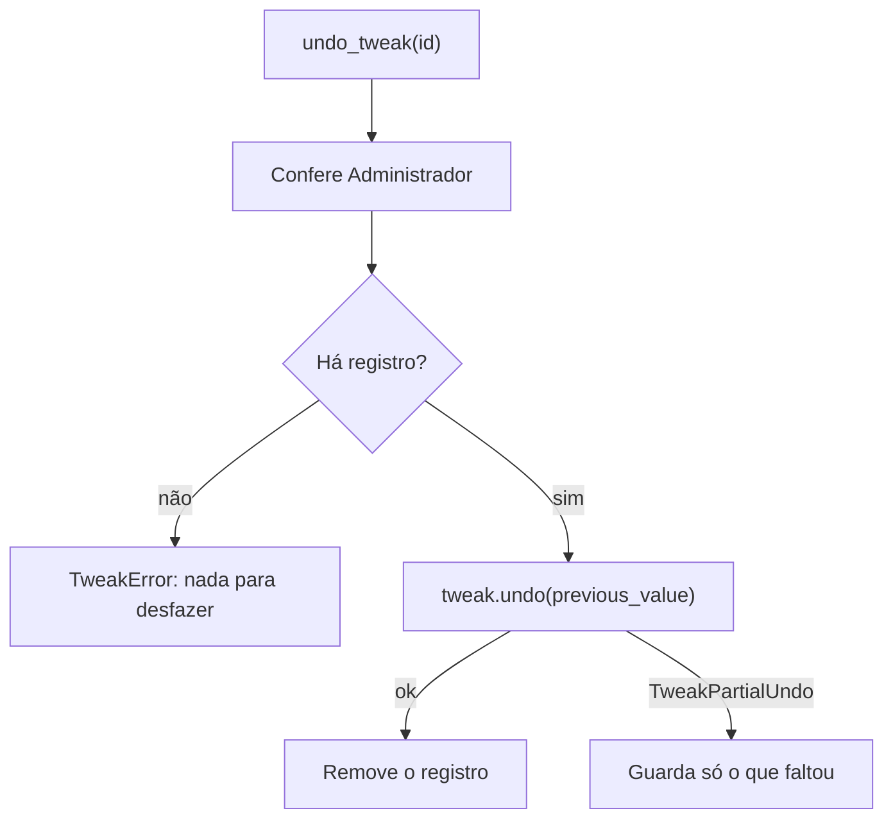

# 04 — Desfazer ajustes

← Anterior: [03 — Ajustes reversíveis](03-ajustes-reversiveis.md) · [Funcionalidades](README.md) · Próximo: [05 — Adaptação à máquina](05-adaptacao-a-maquina.md)

**Acesso:** opção 6 do menu, `undo <tweak_id>` ou `undo --all`
**Código:** `undo_tweak` e `undo_all` em [backend/tweaks/manager.py](../../backend/tweaks/manager.py); `_run_undo_flow` em [main.py](../../main.py); [undo_menu.py](../../frontend/components/undo_menu.py)
**Testes:** [tests/test_undo_option.py](../../tests/test_undo_option.py), [tests/test_tweaks/test_partial_undo.py](../../tests/test_tweaks/test_partial_undo.py), [tests/test_tweaks/test_manager.py](../../tests/test_tweaks/test_manager.py)

---

## 1. Para que serve

Devolve cada configuração ao valor que tinha antes do programa mexer nela. Não restaura arquivos apagados nem drivers.

## 2. Como usar

**No menu:** escolha a opção 6, confira a lista e responda *Reverter agora?*. O resultado mostra OK ou FALHA por ajuste, e o programa volta ao menu.

**Na linha de comando:**

```bash
python main.py undo telemetry
python main.py undo --all
```

## 3. Regras e casos especiais

| Situação | Resultado |
| --- | --- |
| Nada aplicado | *Nenhum ajuste aplicado: nada para desfazer.* |
| Ajuste que exige admin sem elevação | Listado no aviso; falha com o motivo, e os demais seguem |
| Valor original não existia | O valor é apagado, sem gravar um valor vazio |
| Agregado parcialmente restaurado | Só o que faltou fica no estado, para tentar de novo |
| Queda durante `apply` | O registro `pending` permite desfazer |
| Arquivo de estado danificado | Para com `StateCorruptError`; ver [FAQ](../10-glossario-e-faq.md#problemas) |
| Serviço que iniciava sozinho | Volta ao tipo original e é iniciado |
| `undo --all` com falha | Código de saída 1 |

## 4. Por dentro



**Figura 1 — Desfazer um ajuste**

`undo_all` percorre os registros do mais recente para o mais antigo, pela sequência `_seq`, e sobrevive a erros de cada ajuste. A ordem independe da resolução do relógio do sistema.

## 5. Desfazer ao desinstalar

Se existir um estado salvo, o desinstalador pergunta se deve rodar `undo --all` antes de remover os arquivos. Ver [07 — CI e instalador](../07-ci-e-instalador.md).

## 6. Por que é assim

| Decisão | Motivo |
| --- | --- |
| Registro por ajuste, não histórico | Só o valor original importa |
| Ordem inversa | Desfaz na ordem contrária à aplicação |
| Falha parcial preserva o restante | Tentar de novo não pode perder itens |
| O menu lê só o arquivo de estado | Abre rápido, sem consultar o Windows |

---

← Anterior: [03 — Ajustes reversíveis](03-ajustes-reversiveis.md) · [Funcionalidades](README.md) · Próximo: [05 — Adaptação à máquina](05-adaptacao-a-maquina.md)
