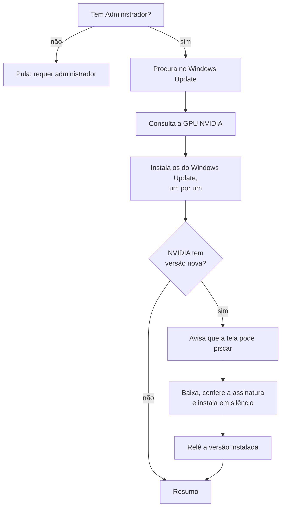

# 07 — Atualização de drivers

← Anterior: [06 — Ficha da máquina](06-ficha-da-maquina.md) · [Funcionalidades](README.md) · Próximo: [08 — Ponto de restauração](08-ponto-de-restauracao.md)

**Acesso:** pergunta antes da execução em `menu` e `clean`, ou `--drivers`
**Código:** [backend/drivers.py](../../backend/drivers.py), [backend/nvidia_driver.py](../../backend/nvidia_driver.py); `_run_driver_step` em [main.py](../../main.py)
**Testes:** [tests/test_drivers.py](../../tests/test_drivers.py), [tests/test_nvidia_driver.py](../../tests/test_nvidia_driver.py)

---

## 1. Para que serve

Instala, um por um, os drivers pendentes no Windows Update e o driver NVIDIA mais novo. É a única parte do programa que usa a rede.

> ⚠️ **Drivers não têm desfazer pelo programa.** A proteção é o [ponto de restauração](08-ponto-de-restauracao.md) criado antes da execução.

## 2. Quando roda

**Tabela 1 — Decisão por opção**

| Opção | Resultado |
| --- | --- |
| `--no-drivers` | Não roda |
| `--drivers` | Roda sem perguntar |
| `--dry-run` | Só lista o que está pendente |
| `-y` sozinho | Não roda |
| Nenhuma | Pergunta; o padrão é **não** |

## 3. Como funciona

**Figura 1 — Etapa de drivers**

## 4. Regras e casos especiais

| Situação | Resultado |
| --- | --- |
| Um driver falha | Registrado; os outros continuam |
| Busca no Windows Update falha | Registrada; a NVIDIA ainda roda |
| Sem GPU NVIDIA | Nada a fazer para a NVIDIA |
| GPU fora do catálogo ou serviço indisponível | Etapa NVIDIA pulada com mensagem |
| Mais de uma GPU NVIDIA | Só a primeira é verificada |
| URL de download inesperada | Recusada |
| Assinatura inválida | Não executa |
| Driver novo presente depois da instalação | Sucesso, com qualquer código de saída |
| Código 0, driver antigo ainda carregado | Sucesso, com pedido de reinício |
| Versão instalada ilegível, código 0 | Sucesso |
| Outro caso | Falha, com o código de saída |

## 5. Segurança do download NVIDIA

1. A consulta usa só HTTPS.
2. A URL precisa ser `https`, estar em `nvidia.com` e terminar em `.exe`.
3. O arquivo baixado precisa ter assinatura Authenticode **válida** da **NVIDIA Corporation**.
4. O instalador roda com `-s -noreboot -noeula`, sem `-clean`, preservando as configurações.
5. O arquivo temporário é apagado ao final, com ou sem sucesso.

## 6. Por que é assim

| Decisão | Motivo |
| --- | --- |
| Consentimento à parte | Baixa muito e não tem desfazer simples |
| `-y` não implica drivers | Automatizar a limpeza não deve mudar drivers |
| Um por um | Uma falha não derruba os demais |
| Validar `UpdateID` como GUID | O valor entra em um script PowerShell |
| Série de notebook pelo chassi | GPUs antigas não trazem "Laptop" no nome |

---

← Anterior: [06 — Ficha da máquina](06-ficha-da-maquina.md) · [Funcionalidades](README.md) · Próximo: [08 — Ponto de restauração](08-ponto-de-restauracao.md)
