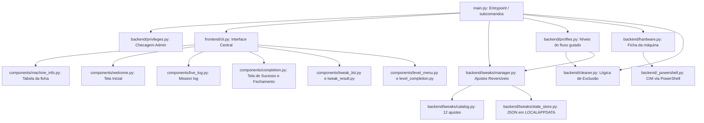
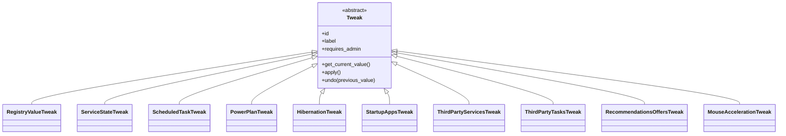
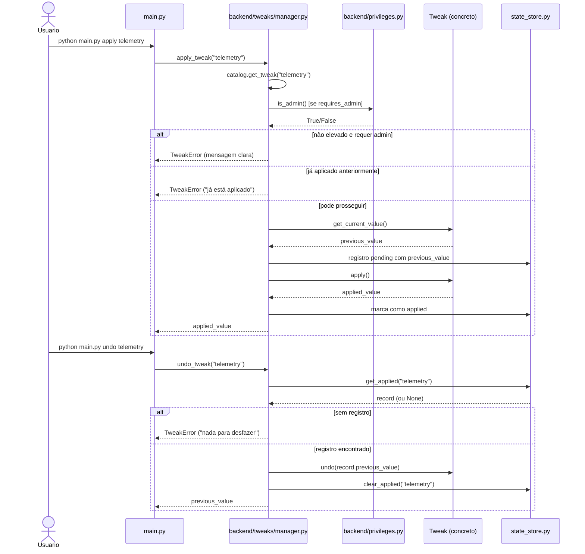
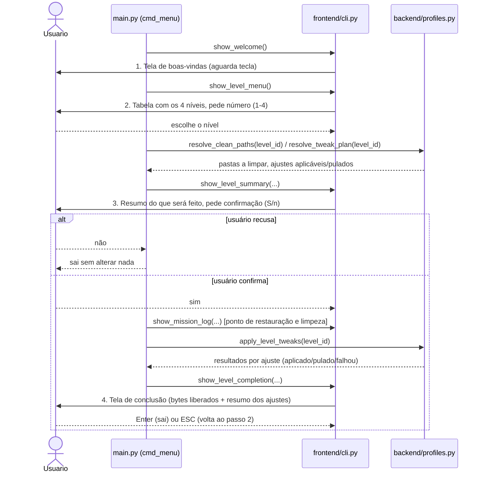

# Documentação de Funcionamento do System Boost

Esta documentação descreve detalhadamente a arquitetura, o fluxo de execução e a lógica interna do **System Boost**, utilitário que limpa arquivos temporários do Windows e aplica ajustes reversíveis. O nome antigo, WinCleaner, ainda aparece na pasta de dados `%LOCALAPPDATA%\WinCleaner`, mantida para preservar o estado de instalações existentes.

---

## 🛠️ Arquitetura Geral

O projeto segue uma arquitetura modular, dividida claramente entre a lógica de negócios (**Backend**) e a interface de console interativa (**Frontend**):



**`python main.py` sem argumentos agora abre o fluxo guiado (`menu`)** — o comando `clean` continua existindo para o comportamento direto de antes.

---

## 📂 Estrutura de Arquivos e Funções

### 1. Ponto de Entrada (`main.py`)
Responsável por orquestrar o ciclo de vida completo do aplicativo:
*   Inicializa e exibe a tela de boas-vindas.
*   Determina os privilégios do usuário. Se **não for administrador**, restringe a limpeza apenas à pasta temporária do usuário (`User Temp`). Se **for administrador**, habilita a limpeza do sistema e do `Prefetch`.
*   Abre o mission log, cria o ponto de restauração e dispara a exclusão física dos arquivos.
*   Exibe a tela de encerramento com o total de bytes liberados.

### 2. Backend (`/backend`)

#### 📄 `backend/privileges.py`
Gerencia a detecção de privilégios elevados.
*   `is_admin()`: Usa a DLL do Windows `shell32.IsUserAnAdmin` para detectar se a execução possui privilégios de Administrador. Se executado em um ambiente sem suporte à chamada, retorna `False`.

#### 📄 `backend/cleaner.py`
Contém as regras de negócio para análise e exclusão física de arquivos e diretórios:
*   `get_temp_paths()`: Mapeia as pastas padrão do Windows:
    *   **User Temp**: `%TEMP%` (normalmente `C:\Users\<user>\AppData\Local\Temp`).
    *   **System Temp**: `C:\Windows\Temp`.
    *   **Prefetch**: `C:\Windows\Prefetch`.
    *   **SquirrelTemp** (`%LOCALAPPDATA%\SquirrelTemp`), **Gradle Cache** (`~/.gradle/caches`), **Go Build Cache** (`%LOCALAPPDATA%\go-build`), **User Cache** (`~/.cache`): pastas do usuário, sem admin.
*   `get_dir_size(path)`: Calcula recursivamente o tamanho total de um diretório em bytes utilizando varredura rápida (`os.scandir`).
*   `format_size(size_bytes)`: Formata bytes para unidades humanas legíveis (`B`, `KB`, `MB`, `GB`, `TB`).
*   `clean_directory(directory_path, progress_callback)`: Executa a exclusão de arquivos e subdiretórios com segurança:
    *   Arquivos abertos ou bloqueados pelo sistema/outros programas geram `PermissionError` e são **pulados silenciosamente** sem travar o aplicativo.
    *   Dispara um callback em tempo real para atualizar o progresso visual na interface.
    *   Links não são percorridos. Raízes sensíveis são recusadas (`is_safe_clean_root`). `CLEAN_RULES` mantém arquivos com menos de 24 h em User/System Temp e caches de modelos em `~/.cache`.
*   npm e uv: a pasta de cache é limpa diretamente, sem executar a ferramenta.

#### 📄 `backend/hardware.py`
Coleta a "ficha da máquina" (comando `info`). Backend puro, sem UI, **nunca levanta exceção**: cada campo que falhar fica `None` (ou `[]` para GPUs) e a tela mostra "desconhecido". Não exige Administrador.
*   `get_machine_info()`: devolve um `MachineInfo` (`windows`, `version`, `build`, `cpu`, `threads`, `ram_gb`, `gpus`, `disk_type`, `disk_model`, `disk_bus`, `form_factor`).
*   **Windows / CPU** via `winreg` (`HKLM\SOFTWARE\Microsoft\Windows NT\CurrentVersion` e `HKLM\HARDWARE\DESCRIPTION\System\CentralProcessor\0`). O `ProductName` do registro ainda diz "Windows 10" no Windows 11, então a compilação ≥ 22000 troca o nome para "Windows 11". A compilação é exibida como `CurrentBuildNumber.UBR`.
*   **RAM** via `ctypes`: `GetPhysicallyInstalledSystemMemory` (memória instalada nos pentes); se falhar, `GlobalMemoryStatusEx` (total utilizável).
*   **GPU, disco e tipo** em **uma única** chamada PowerShell/CIM (`Win32_VideoController`, `Get-PhysicalDisk` do disco onde está o Windows, `Win32_SystemEnclosure.ChassisTypes`, `Win32_Battery`), com um `try/catch` por bloco no script para uma consulta ruim não derrubar as outras. Os valores lidos (`MediaType`, `BusType`, tipos de chassi) são enums e não são traduzidos pelo idioma do Windows. NVMe com `MediaType` vazio é tratado como SSD.
*   **Notebook × Desktop**: chassi 8/9/10/11/14/30/31/32 → Notebook; qualquer outro chassi informativo → Desktop; chassi "Outro/Desconhecido" (1/2) usa a presença de bateria como desempate.

#### 📄 `backend/_powershell.py`
`run_powershell(script, timeout)` + `PowerShellError`: executa `powershell.exe` sem perfil, sem stdin, com timeout, e devolve stdout decodificado (`utf-8-sig`). `drivers.py` usa esta função e converte `PowerShellError` em `DriverError`.

---

### 3. Frontend (`/frontend`)

Interface retrô 8-bit feita com a biblioteca `rich`. As cores vêm do tema da paleta ativa (`frontend/palettes.py`), nunca fixas nos componentes.

#### 📄 `frontend/cli.py`
Ponto único entre `main.py` e os componentes: cria o `Console` com o tema da paleta e expõe as funções `show_*`.

#### 📄 `frontend/components/welcome.py`
*   Mostra o logo e o painel "PRESS ANY KEY", centralizados.
*   Aguardar qualquer tecla usando a captura direta de teclado do Windows (`msvcrt.getch()`).

#### 📄 `frontend/components/live_log.py`
*   `MissionLog`: uma linha por etapa, com estado em andamento, OK, FAIL, SKIP ou aviso.
*   O log completo continua na tela, acima do resumo final.

#### 📄 `frontend/components/machine_info.py`
*   `display_machine_info(console, info)`: tabela "A ficha da máquina" com Windows, Processador, Memória, Placa de vídeo (uma linha por GPU), Disco do sistema e Tipo. Campos vazios aparecem como `desconhecido`.

#### 📄 `frontend/components/undo_menu.py`
*   `display_undo_confirm(console, applied, admin)`: lista os ajustes que serão revertidos, avisa os que exigem Administrador quando a sessão não está elevada e pergunta "Reverter agora?".
*   `display_undo_empty(console, wait)`: "Nenhum ajuste aplicado".
*   `display_undo_results(console, results, wait)`: OK/FALHA por ajuste e o total desfeito.

#### 📄 `frontend/components/completion.py`
*   Exibe o painel de sucesso com o total limpo.
*   Aguarda o input do usuário para sair.
*   **Fechamento Inteligente do Terminal (Windows)**:
    *   Após a leitura da tecla, o código detecta o handle do console atual usando `ctypes.windll.kernel32.GetConsoleWindow()`.
    *   Se um handle de janela for encontrado, envia de forma assíncrona um evento `WM_CLOSE` (`0x0010`) para a fila de mensagens da janela host com `ctypes.windll.user32.PostMessageW()`.
    *   Isso força o fechamento imediato e limpo da janela do PowerShell, CMD ou Windows Terminal que hospedou o aplicativo.

---

## 🚀 Fluxo de Execução Detalhado

O diagrama de atividades abaixo ilustra o comportamento passo a passo desde a inicialização do programa até o encerramento do processo:

```mermaid
sequenceDiagram
    actor Usuario
    participant Main as main.py
    participant Privs as backend/privileges.py
    participant Cleaner as backend/cleaner.py
    participant CLI as frontend/cli.py
    participant Completion as components/completion.py

    Usuario->>Main: Executa python main.py clean
    Main->>CLI: show_welcome()
    CLI->>Usuario: Exibe painel inicial e aguarda tecla
    Usuario->>CLI: Pressiona tecla
    Main->>Privs: is_admin()
    Privs-->>Main: Retorna True/False (Admin Status)
    Main->>Cleaner: get_temp_paths()
    Cleaner-->>Main: Retorna caminhos disponíveis
    Main->>CLI: show_clean_confirm(paths_to_clean)
    Main->>CLI: show_mission_log(title)
    rect rgb(30, 30, 40)
        Note over Main, Cleaner: Uma linha do log por pasta
        Main->>Cleaner: clean_directory(path)
        Cleaner-->>Main: Retorna bytes liberados
    end
    Main->>CLI: show_completion(total_formatted)
    CLI->>Completion: display_completion_screen()
    Completion->>Usuario: Exibe total limpo e pede tecla
    Usuario->>Completion: Pressiona tecla de saída
    Completion->>Completion: Executa GetConsoleWindow()
    alt Possui Console Ativo (Windows)
        Completion->>Completion: PostMessageW(hwnd, WM_CLOSE) [Fecha Terminal]
    end
    Completion->>Main: sys.exit(0)
```



---

## 🔄 Ajustes Reversíveis (`backend/tweaks/`)

Subsistema que aplica e desfaz ajustes do Windows, sempre salvando o valor anterior antes de sobrescrever.

### Abstração `Tweak`

Diferente do resto do backend (só funções), aqui é usada uma classe abstrata (`abc.ABC`) porque os 12 ajustes têm mecanismos bem diferentes entre si e precisam de polimorfismo real — uma subclasse que esquecer `undo()` falha na hora de definir a classe, não silenciosamente na hora que o usuário mais precisa que o undo funcione.



As classes são organizadas por **mecanismo** (como falam com o Windows), não uma por ajuste — `RegistryValueTweak` atende tanto `visual_effects` quanto `telemetry`; `ServiceStateTweak` atende tanto `indexing` (WSearch) quanto `sysmain` (SysMain).

### Os 12 ajustes (`backend/tweaks/catalog.py`)

| id | admin? | leitura (locale-safe) | escrita | valor salvo para undo |
|---|---|---|---|---|
| `power_plan` | não | `winreg` `ActivePowerScheme` | `powercfg /setactive` | GUID do plano anterior |
| `hibernation` | sim | `winreg` `HibernateEnabled` | `powercfg /hibernate off` | 0/1 |
| `visual_effects` | não | `winreg` (HKCU) `VisualFXSetting` | mesma chave | int ou `null` |
| `telemetry` | sim | `winreg` `AllowTelemetry` | mesma chave | int ou `null` (undo apaga o valor se estava ausente) |
| `indexing` | sim | `winreg` `Services\WSearch\Start` | `sc config` + `sc stop` | tipo de start (string) |
| `sysmain` | sim | `winreg` `Services\SysMain\Start` | `sc config` + `sc stop` | tipo de start (string) |
| `compat_appraiser` | sim | `schtasks /Query /XML` (nome com ou sem `Exp`) | `schtasks /Change` | `"Enabled"`/`"Disabled"` |
| `startup_apps` | não | itens de inicialização | desativa programas de terceiros | lista de itens alterados |
| `third_party_services` | sim | serviços automáticos | muda para manual e para o serviço | lista de itens alterados |
| `third_party_tasks` | sim | tarefas fora de `\Microsoft\` | desativa a tarefa | lista de itens alterados |
| `recommendations_offers` | não | `winreg` | desliga as opções de recomendações e ofertas | valores anteriores |
| `mouse_acceleration` | não | `winreg` | desliga a precisão do ponteiro | valores anteriores |

`startup_apps`, `third_party_services` e `third_party_tasks` usam o filtro de `third_party.py`, que preserva itens do Windows, antivírus, drivers, VPN, bancos de dados, backup, licenciamento e atualizadores. Serviços em início atrasado são lidos como `delayed-auto` e voltam a esse modo no undo.

**Leituras usam `winreg`, não parsing de saída de `.exe`** — a saída de `sc.exe`/`schtasks.exe`/`powercfg.exe` é localizada no idioma do Windows (esta interface é pt-BR, então o risco é real). Escritas continuam usando os `.exe`s porque as flags de linha de comando são fixas, não traduzidas. Um detalhe descoberto durante o desenvolvimento: `schtasks /XML` declara `encoding="UTF-16"` no prólogo do XML, mas os bytes capturados via pipe redirecionado são, na prática, UTF-8 — `scheduled_tasks.py` decodifica como texto (UTF-8) antes de entregar ao `ElementTree`, em vez de deixar o `ET.fromstring` confiar numa declaração que não bate com os bytes reais.

### Persistência de estado (`backend/tweaks/state_store.py`)

Arquivo JSON em `%LOCALAPPDATA%\WinCleaner\tweaks_state.json`, escrita atômica (arquivo temporário + `os.replace`). Um registro por `tweak_id` (não é um log de eventos):

```json
{
  "_schema_version": 1,
  "_next_seq": 2,
  "tweaks": {
    "telemetry": {
      "tweak_id": "telemetry",
      "applied_at": "2026-09-23T18:05:02-03:00",
      "previous_value": null,
      "applied_value": 0,
      "requires_admin": true,
      "_seq": 2
    }
  }
}
```

Um registro nasce com `status: "pending"` antes de `apply()` e vira `applied` depois, então uma queda no meio ainda permite desfazer. Arquivo danificado nunca é sobrescrito (`StateCorruptError`, cópia `.corrupt-*`), e cada gravação mantém `.bak`. Se um undo agregado falha em parte, `TweakPartialUndo` mantém no estado só os itens restantes.

`previous_value: null` é um valor significativo (a chave/valor não existia antes) — `undo()` **apaga** o valor do registro em vez de escrever `null`. Reaplicar um ajuste já aplicado (sem desfazer antes) é **rejeitado**, nunca sobrescrito — sobrescrever destruiria o valor original verdadeiro. `_seq` é um contador interno usado para ordenar `undo --all` do mais recente para o mais antigo, independente de resolução do relógio do sistema.

### Fluxo de `apply` / `undo` (`backend/tweaks/manager.py`)



**Admin: falha clara, nunca auto-elevação via UAC.** Se um ajuste exige admin e o terminal não está elevado, `manager.py` levanta `TweakError` com mensagem pedindo para reabrir como Administrador — não tenta relançar o processo elevado. Isso mantém `--yes`/uso automatizado viável e evita um prompt de elevação surpresa, coerente com o princípio de "sem login/conta/telemetria própria" do projeto.

`list`, `apply <id>` e `undo <id>|--all` são subcomandos de `main.py` (via `argparse.add_subparsers()`). Sem subcomando, só `--dry-run` é aceito e implica `clean`.

---

## 🧭 Fluxo Guiado (`menu`) — comportamento padrão

Quando `python main.py` é executado sem argumentos, o subcomando `menu` é implícito e apresenta um fluxo guiado por 4 telas.

> **Opção 6 do menu — "Desfazer ajustes":** lista os ajustes aplicados (`manager.list_applied()`, lido do state file), pede confirmação, chama `undo_all()` e mostra OK/FALHA por ajuste, voltando ao menu. Sem Administrador, os ajustes que exigem admin aparecem como falha com o motivo. A tela de conclusão e o briefing de cada nível informam esse caminho (`REVERT_HINT`).

> **Opção 5 do menu — "Ver ficha da máquina":** além dos 4 níveis, o menu tem uma quinta opção que mostra a ficha (`backend/hardware.py`), espera uma tecla e volta ao menu, sem passar pelo resumo nem executar nada. O hardware é lido uma única vez por sessão (`display_level_menu` devolve `INFO_CHOICE` e `cmd_menu` guarda o resultado).



Na tela de conclusão (passo 4), **Enter** (ou qualquer tecla além de ESC) encerra o programa — fechando o terminal, igual ao `clean` — e **ESC** volta direto para o menu de níveis (passo 2), sem repetir a tela de boas-vindas, permitindo escolher outro nível na mesma sessão.

### Os 4 níveis (`backend/profiles.py`)

`menu --level <id>` pula o menu; com `-y`, roda sem interação.

| Nível | Pastas limpas | Ajustes aplicados |
|---|---|---|
| Leve | User Temp, Lixeira | `startup_apps`, `third_party_services`, `third_party_tasks` |
| Mediana | + System Temp, SquirrelTemp, Gradle/Go/User Cache, npm/uv cache | + `power_plan`, `recommendations_offers`, `mouse_acceleration`, `hibernation` |
| Alta | + Prefetch | + `visual_effects`, `indexing` |
| Extrema | (mesmas de Alta) | + `telemetry`, `sysmain`, `compat_appraiser` |

**Adaptação à máquina**: a ficha de `get_machine_info()` vai para `resolve_tweak_plan`, `resolve_clean_paths` e `apply_level_tweaks`. Em HDD ficam fora `sysmain` e a limpeza do Prefetch; em notebook, `hibernation` e `power_plan`. Hardware desconhecido não exclui nada, e `apply <id>` continua aplicando sob pedido.

**Ajustes agregados** (`startup_apps`, `third_party_services`, `third_party_tasks`): reaplicar trata só os itens novos e os soma ao registro, gravando antes de `apply()`. Item já registrado mantém o valor original.

Cada nível é uma lista declarativa de pastas + comandos de limpeza (`clean_commands`: `npm-cache`, `uv-cache`, `recycle-bin`, executados por `cleaner.run_command_cleanup()`, que ignora ferramenta não instalada e mede o ganho antes/depois) + ids de ajustes em `profiles.LEVELS`; o Stage 2 (Mediana) inclui a "Lista C" e o ajuste `hibernation` (remove o hiberfil.sys; perde hibernação/inicialização rápida); `resolve_clean_paths()` reaproveita `cleaner.get_temp_paths()` e o mesmo filtro por admin que `cmd_clean` já tinha, e `apply_level_tweaks()` reaproveita `tweaks.manager.apply_tweak()` ajuste por ajuste.

**Degradação graciosa, igual ao `clean`**: se o terminal não está elevado, ajustes que exigem admin (e pastas que exigem admin) são automaticamente pulados — nunca travam a execução do nível inteiro. A tela de resumo (passo 3) já mostra separadamente o que vai rodar e o que vai ser pulado por falta de admin, antes de qualquer coisa ser alterada; a tela de conclusão (passo 4) reporta quantos ajustes foram aplicados, pulados e (se algum já estava aplicado de uma execução anterior) quantos falharam.

A tela de conclusão do `menu` reaproveita o mesmo mecanismo de "aguardar tecla + fechar terminal" (`WM_CLOSE`) que o `clean` já usa — foi extraído para `frontend/components/_terminal.py` para não duplicar essa lógica. `list`/`apply`/`undo` continuam sem essa cerimônia, já que são pensados para rodar em sequência num terminal já aberto.

---

## 📦 Compilação Automatizada

O arquivo `build.py` automatiza todo o empacotamento do utilitário utilizando o **PyInstaller**:
*   Instala as dependências de `requirements-build.txt`. `requirements.txt` tem só o runtime; `requirements-dev.txt` traz testes e lint.
*   Gera arquivo único com manifesto `requireAdministrator` e nome `System Boost`.
*   O resultado final fica em `dist/System Boost.exe`. Se a assinatura estiver configurada e falhar, o build termina com erro.
