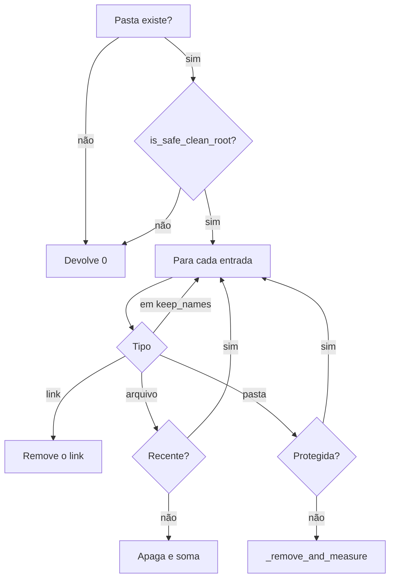

# Módulo Cleaner — medir e apagar com segurança

← Anterior: [Hardware](hardware.md) · [Módulos](README.md) · Próximo: [Tweaks](tweaks.md)

**Arquivo:** [backend/cleaner.py](../../backend/cleaner.py)
**Testes:** [tests/test_cleaner.py](../../tests/test_cleaner.py), [tests/test_state_survives_cleanup.py](../../tests/test_state_survives_cleanup.py)
**Funcionalidade:** [Limpeza de temporários](../funcionalidades/02-limpeza.md)

> **Resumo:** localiza pastas temporárias, mede o tamanho delas e apaga o conteúdo, recusando caminhos perigosos e nunca seguindo links.

---

## 1. Explicação para leigos

É o **faxineiro com regras**: só entra nos cômodos combinados, não mexe no que está em uso, não atravessa portas que levam a outro lugar e anota quanto tirou.

## 2. Funções

**Tabela 1 — API do módulo**

| Função | Faz |
| --- | --- |
| `get_temp_paths()` | Mapa `{nome: caminho}` das pastas que existem |
| `clean_directory(path, progress_callback, dry_run, min_age_seconds, keep_names)` | Apaga ou mede o conteúdo; devolve os bytes |
| `get_dir_size(path, protected, cutoff)` | Soma recursiva, sem seguir links |
| `format_size(bytes)` | Texto legível, como `1.32 GB` |
| `is_safe_clean_root(path)` | `False` para raízes que nunca podem ser esvaziadas |
| `run_command_cleanup(id, dry_run)` | Lixeira, npm ou uv: devolve `(status, bytes)` |

**Tabela 2 — Constantes**

| Constante | Conteúdo |
| --- | --- |
| `ADMIN_ONLY_PATHS` | System Temp e Prefetch |
| `CLEAN_RULES` | Idade mínima de 24 h e nomes preservados, por pasta |
| `COMMAND_CLEANUPS` | Rótulo, ferramenta exigida, medir e limpar |

## 3. Algoritmo de `clean_directory`

**Figura 1 — Decisão por entrada**

Em `--dry-run`, os mesmos caminhos só medem. Erros de arquivo em uso são contados e registrados no log.

## 4. Raízes recusadas

`is_safe_clean_root` recusa caminhos relativos, a raiz de uma unidade e qualquer pasta que **seja ou contenha** o Windows, o perfil do usuário, Desktop, Documents, Downloads, `LOCALAPPDATA`, `APPDATA`, `ProgramData` ou `Program Files`.

## 5. Por que foi feito assim

| Decisão | Motivo |
| --- | --- |
| Tratar junções à mão | `is_symlink()` não as detecta, e `is_dir()` diria para entrar |
| Só `.gradle\caches` | `~/.gradle` guarda `gradle.properties`, com credenciais |
| Proteger `sys._MEIPASS` | O exe roda de uma pasta em Temp e precisa dela até o fim |
| Medir e apagar em uma passada | Evita varrer a mesma árvore duas vezes |
| `max(mtime, ctime)` | Arquivos extraídos mantêm datas antigas |

---

← Anterior: [Hardware](hardware.md) · [Módulos](README.md) · Próximo: [Tweaks](tweaks.md)
