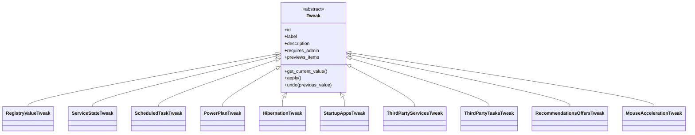

# Módulo Tweaks — ajustes reversíveis

← Anterior: [Cleaner](cleaner.md) · [Módulos](README.md) · Próximo: [Profiles](profiles.md)

**Pasta:** [backend/tweaks/](../../backend/tweaks/)
**Testes:** [tests/test_tweaks/](../../tests/test_tweaks/)
**Funcionalidades:** [Ajustes reversíveis](../funcionalidades/03-ajustes-reversiveis.md) · [Desfazer ajustes](../funcionalidades/04-desfazer.md)

> **Resumo:** subsistema que aplica e desfaz mudanças no Windows, sempre gravando o valor anterior em disco antes de alterar qualquer coisa.

---

## 1. Explicação para leigos

É como um **eletricista que fotografa o quadro antes de mexer**. Cada interruptor tem uma etiqueta com a posição original, e a etiqueta é colada antes de o interruptor mudar. Se a luz cair no meio do trabalho, a etiqueta continua lá.

## 2. Estrutura

**Tabela 1 — Arquivos do subsistema**

| Arquivo | Papel |
| --- | --- |
| `base.py` | Classe abstrata `Tweak` e exceções |
| `catalog.py` | Instancia os 12 ajustes |
| `manager.py` | Ordem segura de aplicar, desfazer e listar |
| `state_store.py` | Estado em JSON |
| `third_party.py` | Filtro de terceiros |
| `registry_value.py` | `RegistryValueTweak`: um DWORD |
| `services.py` | `ServiceStateTweak`: tipo de início de um serviço |
| `scheduled_tasks.py` | `ScheduledTaskTweak`: uma tarefa |
| `power_plan.py`, `hibernation.py` | Energia, por `powercfg` |
| `startup_apps.py` | Inicialização, por `StartupApproved` |
| `third_party_services.py`, `third_party_tasks.py` | Agregados de serviços e tarefas |
| `recommendations_offers.py`, `mouse_acceleration.py` | Grupos de valores do registro |



**Figura 1 — Hierarquia de ajustes**

**Tabela 2 — Exceções**

| Exceção | Quando |
| --- | --- |
| `TweakError` | Ajuste desconhecido, sem permissão ou falha |
| `TweakAlreadyApplied` | Reaplicar sem nada novo |
| `TweakPartialUndo` | Agregado não restaurou tudo; `remaining` guarda o resto |
| `StateCorruptError` | Arquivo de estado não confiável |

## 3. Funções do `manager`

**Tabela 3 — API pública**

| Função | Faz |
| --- | --- |
| `apply_tweak(id, state_path)` | Aplica, salvando antes; em agregado já aplicado, trata itens novos |
| `undo_tweak(id, state_path)` | Restaura e remove o registro |
| `undo_all(state_path)` | Desfaz tudo, do mais recente ao mais antigo; devolve `(id, ok, erro)` |
| `list_status(state_path)` | `(tweak, valor atual, registro)` de todo o catálogo |
| `list_applied(state_path)` | `(tweak, registro)` dos aplicados, lendo só o arquivo |

## 4. Estado em disco

O arquivo `%LOCALAPPDATA%\WinCleaner\tweaks_state.json` tem um registro por ajuste:

```json
{
  "_schema_version": 1,
  "_next_seq": 2,
  "tweaks": {
    "telemetry": {
      "tweak_id": "telemetry",
      "applied_at": "2026-09-23T18:05:02-03:00",
      "previous_value": null,
      "applied_value": 0,
      "status": "applied",
      "requires_admin": true,
      "_seq": 2
    }
  }
}
```

| Campo | Significado |
| --- | --- |
| `previous_value` | Valor a restaurar; `null` significa que não existia |
| `status` | `pending` antes de `apply()`, `applied` depois |
| `_seq` | Ordem de aplicação, usada por `undo --all` |

Toda escrita copia o arquivo para `.bak`, grava um temporário e o troca com `os.replace`. Um arquivo danificado nunca é sobrescrito.

## 5. Detalhes por mecanismo

**Tabela 4 — Como cada ajuste lê e escreve**

| Ajuste | Leitura | Escrita |
| --- | --- | --- |
| `power_plan` | `ActivePowerScheme` no registro | `powercfg /setactive` |
| `hibernation` | `HibernateEnabled` no registro | `powercfg /hibernate` |
| `visual_effects` | `VisualFXSetting` (HKCU) | Mesmo valor (`2`) |
| `telemetry` | `AllowTelemetry` (HKLM) | Mesmo valor (`0`) |
| `indexing`, `sysmain` | `Start` e `DelayedAutostart` do serviço | `sc config` e `sc stop` |
| `compat_appraiser` | `schtasks /Query /XML` | `schtasks /Change` |
| `startup_apps` | Chaves `Run`, pastas Inicializar e `StartupApproved` | `StartupApproved`, com o marcador de desativado |
| `third_party_services` | Chaves de serviço no registro | `sc config start= demand` e `sc stop` |
| `third_party_tasks` | `Get-ScheduledTask` fora de `\Microsoft\` | `schtasks /Change` |
| `recommendations_offers` | Valores DWORD em HKCU | Mesmos valores |
| `mouse_acceleration` | `MouseSpeed` e limiares em HKCU | Mesmos valores e `SPI_SETMOUSE`, que vale na hora |

## 6. Por que foi feito assim

| Decisão | Motivo |
| --- | --- |
| Classe abstrata | Esquecer `undo()` impede a criação do objeto |
| Por mecanismo | Dois ajustes de registro não precisam de duas classes |
| `previews_items` | Marca os agregados, que têm prévia e tratam itens novos |
| Estado passado por `state_path` | Cada teste usa um arquivo próprio |

Registros completos em [D2, D4, D5, D6, D9, D10 e D11](../08-decisoes-de-projeto.md).

---

← Anterior: [Cleaner](cleaner.md) · [Módulos](README.md) · Próximo: [Profiles](profiles.md)
